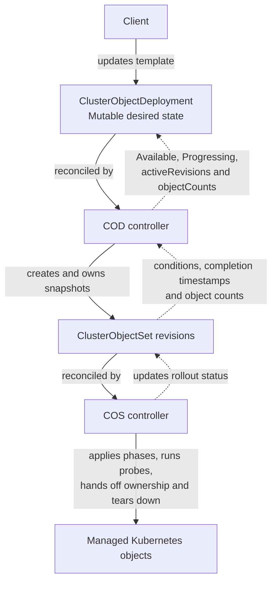
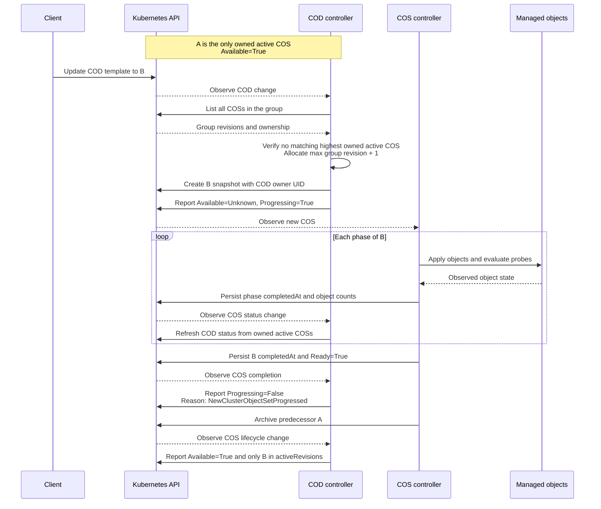

# ClusterObjectDeployment contract

ClusterObjectDeployment (COD) is a mutable orchestration resource that creates
ClusterObjectSet (COS) snapshots and observes their rollout. This proposal defines
the template, revision lifecycle, and status contract for COD and COS.

The design was prototyped in [orb-operator][orb-poc].

## Responsibilities

COD owns revision creation, template metadata propagation, and rollout status.
COS owns phased application, probes, shared-object ownership handoff, and teardown.
Clients update one COD instead of allocating revision numbers themselves.

Group membership and controller ownership answer different questions. All COSs
with the same immutable `spec.group` are revision-chain members. COD manages only
COSs controlled by its UID or legitimately adopted from an ownerless state. Revision
allocation considers the whole group; COD health and revision summaries use its
owned subset. A foreign controller reference is not replaced.

Solid arrows show reconciliation and application; dotted arrows show status
feedback.



## Desired API

The resource is cluster-scoped, has short name `cod`, and uses
`olm.operatorframework.io/v1`. Its status is updated through the status subresource.
The outer spec and template remain mutable.

| Field | Proposed contract |
|---|---|
| `spec.progressDeadlineMinutes` | Optional `*int32`; minimum 1 when supplied. Omitted means no deadline. Explicit 0 is invalid. It belongs to COD, outside the revision template. |
| `spec.template` | Required template with bounded metadata and a COS content spec. |
| `spec.template.metadata.labels` | Optional map of at most 32 Kubernetes-valid labels, copied onto each COS. |
| `spec.template.metadata.annotations` | Optional map of at most 32 Kubernetes-valid annotations, copied onto each COS. |
| `spec.template.spec.collisionProtection` | Optional enum: `Prevent`, `IfNoController`, or `None`. Omitted has effective value `Prevent`, which COD writes explicitly into COS's required field. |
| `spec.template.spec.phases` | Required ordered list of 1–20 uniquely named `ClusterObjectSetPhase` entries. Reuse the existing phase/object validation, including the 50-object phase limit. |
| `spec.template.spec.progressionProbes` | Optional `[]ProgressionProbe` with the existing selector/assertion types and validation. Preserve the current COS probe API until its separate redesign. |

Reuse [the existing COS content types][cos-types].
Objects retain the existing exactly-one-of `object`/`ref` representation; references
continue pointing to immutable Secret content. COD does not dereference or apply
that content. Inline per-object assertions and ClusterObjectSlice references are
separate API extensions outside this proposal.

`group`, `revision`, and `lifecycleState` are controller-assigned COS fields and are
absent from the template. The legacy COS `progressDeadlineMinutes` field is also
absent from the template: COD's inactivity deadline has different semantics and
must not be forwarded into COS. Removing the legacy field is a follow-up change
after clients are migrated to COD.

Template metadata applies to the COS resource, not every managed object. To change
a managed object's labels or annotations, edit that object in the template content.
COD root metadata is not automatically copied. The controller owns
`olm.operatorframework.io/template-hash`; callers cannot supply that key in template
labels. Caller metadata is cloned rather than mutated when constructing a child.

Each annotation value is bounded to 256 KiB. The complete copied annotation map
must also fit Kubernetes' aggregate 256 KiB annotation budget,
including keys and any controller-added annotations. Validation must prevent a
template from producing invalid child metadata.

### Example shape

```yaml
apiVersion: olm.operatorframework.io/v1
kind: ClusterObjectDeployment
metadata:
  name: example
spec:
  progressDeadlineMinutes: 5
  template:
    metadata:
      labels:
        app.kubernetes.io/name: example
    spec:
      collisionProtection: Prevent
      phases:
        - name: namespaces
          objects:
            - object:
                apiVersion: v1
                kind: Namespace
                metadata:
                  name: example
        - name: resources
          objects:
            - object:
                apiVersion: v1
                kind: ConfigMap
                metadata:
                  name: settings
                  namespace: example
                data:
                  mode: enabled
```

This describes the proposed API shape, not an installable resource before the COD
API PR lands. Optional structs use value types and `omitzero`; scalar/map fields use
the repository's established JSON conventions. The deadline pointer preserves the
difference between absence and an invalid explicit zero.

## Template identity and revision identity

Both template metadata and template spec participate in identity. Root metadata,
status, and deadline-only edits do not create a revision. Map key order is
irrelevant; changes to phase, object, or probe list order participate in identity.

Identity uses the declared template, before filling controller-assigned COS fields.
Omission and an explicitly supplied `collisionProtection: Prevent` are
distinct templates even though their effective collision behavior is equal. Editing
between those representations creates a revision. Absent and empty optional maps
have the same serialized representation.

A hash identifies candidates; a label match alone does not establish content
equality or ownership. Matching and `AlreadyExists` recovery verify the effective
child template and controller UID. The concrete hash encoding is an implementation
detail, not a caller-facing promise of collision-free identity.

Each child has `spec.group = COD.metadata.name`, a positive `int64` revision,
`lifecycleState: Active`, and name `{group}-{revision}`. Its controller reference
contains the COD's actual UID. Allocate revision 1 for an empty group, otherwise
the maximum existing group revision plus one, including archived or foreign members.
Refuse allocation at `math.MaxInt64` rather than wrapping. A → B → A creates a new
higher revision; an archived COS cannot be reactivated.

COD names follow the proposed COS group's pattern
`^[a-z]([a-z0-9-]*[a-z0-9])?$` and 1–52 character limit. The limit ensures
`COD.name` is a valid group. Child names must satisfy the CRD's name validation,
using the applicable [Kubernetes object-name rules][names].

## Observed API

COD status exposes conditions, active revisions, and object counts:

| Field | Proposed contract |
|---|---|
| `status.conditions` | `[]metav1.Condition`, keyed by `type`, with `Available` and `Progressing`. |
| `status.activeRevisions` | List keyed by COS `name`, containing the child's current conditions; sorted by increasing revision when written. Includes owned active, non-deleting COSs and a child acknowledged as newly created. |
| `status.objectCounts` | Optional copy of the highest owned active COS's counts: `total`, `present`, `synced`, and `available`. Omitted if that child has not reported counts or no active child exists. |

Counts are not summed across revisions: they may manage overlapping objects. COS
status remains the source for phase and object details. No additional rollout
record, desired-template hash, or timer-start field is proposed in COD status.

Each COD condition records the generation evaluated by the controller.
`observedGeneration` does not mean the desired content is installed; the condition
type and reason supply that meaning. Preserve `lastTransitionTime` while condition
status is unchanged, and avoid identical status writes.

### Available

Available describes the health of the owned active COSs. Count only owned active COSs
that are not being deleted.

| Active revisions | Available status | Reason |
|---|---|---|
| None | `False` | `NotAvailable` |
| Exactly one, with COS `Ready=True` | `True` | `Available` |
| Exactly one, with COS Ready absent, False, or Unknown | `False` | `NotAvailable` |
| More than one | `Unknown` | `Progressing` |

This is current installation health, not a guarantee that the desired template has
completed. If revision A is healthy but creation of B fails, Available remains True
while Progressing reports waiting for B, including the creation error. Once B is
created, Available becomes Unknown during the transition. After a completed revision
becomes unhealthy, Available becomes False without restarting rollout timing.

### Progressing

Evaluate only the highest owned active revision. A historical matching template
or an older completed revision does not complete the current rollout. The selected
child must match the current desired template before its progress is used.

| Current rollout state | Progressing status | Reason |
|---|---|---|
| Matching COS has `completedAt` set | `False` | `NewClusterObjectSetProgressed` |
| Matching COS is incomplete, deadline disabled or not exceeded | `True` | `NewClusterObjectSetProgressing` |
| No matching COS exists; creation is pending, deadline disabled or not exceeded | `True` | `NewClusterObjectSetProgressing` |
| Matching COS or pending creation has exceeded its deadline | `False` | `ProgressDeadlineExceeded` |

Creation failures remain visible in the pending condition message while retries
continue. Completion is a historical latch: a matching COS that completed once
continues reporting `NewClusterObjectSetProgressed` after a health regression.

Progressing=True describes unfinished rollout work. Progressing=False describes
completion or an exceeded deadline; the reason distinguishes those states.

### Example revision rollout

This example starts with one healthy owned revision A and changes the template to
B. The new revision completes without exceeding a deadline. Controllers reconcile
asynchronously, so a reconciliation may observe several changes together.



## Deadline and recovery

With a matching incomplete COS, the milestone is the latest of its creation time
and persisted phase `completedAt` timestamps. A phase completion advances the
milestone; polling, error retries, and condition changes do not. Timeout occurs when
elapsed time is greater than or equal to the configured interval. Completion is
checked first and ends rollout timing even if the deadline previously elapsed.

Without a matching COS, use the persisted Progressing condition to evaluate
pending creation:

| Previous Progressing observation | Pending-creation baseline or result |
|---|---|
| No previous condition | COD creation time. |
| Status True | Its existing `lastTransitionTime`, including across template/generation edits. |
| Status False after a completed rollout | The time the new pending rollout is first observed; the transition to True persists that time. |
| Reason `ProgressDeadlineExceeded` and deadline still enabled | Remain timed out until a matching COS is created, including across template edits or increases to the deadline. |

Successfully creating a matching COS switches to that COS's creation/phase
milestones. Restart reconstructs the same evaluation from persisted conditions and
COS timestamps. Template edits during an ongoing pending rollout retain the
existing condition-based baseline and do not start a fresh creation window.

Deadline-only edits do not stamp a COS. For a matching incomplete COS, evaluate the
new interval against its existing milestone. For a pending timed-out rollout,
the timeout remains while a deadline is enabled. Removing the deadline
must stop reporting `ProgressDeadlineExceeded` and return an incomplete rollout to
Progressing=True. Deadline disablement takes precedence over a previously recorded
pending timeout.

A pending creation always retries, since a failed create may produce no child
event. With a matching child and a configured unexpired deadline, schedule a wakeup
no later than expiry even if no status event arrives. After timeout, retain child
watches and reconciliation; actual later phase progress can resume Progressing,
and completion ends it. Timeout neither archives children nor automatically rolls
back. Arithmetic and requeue calculations must remain safe for every admitted
positive `int32` deadline value.

### Alternative: a persisted rollout record

A future contract could store the desired template identity and a rollout start
timestamp together in COD status. That would allow a distinct creation window for
each new template even when Progressing remains True, and make timer identity
independent of condition transition times. Deadline-only edits would retain the
same record; a template identity change would start a new one. Actual phase progress
would still come from COS timestamps.

This adds API fields and decisions about when the record starts, changes, or is
cleared, including recovery after timeout and parent recreation. It would need
corresponding restart and partial-write tests. The proposed baseline uses condition
timestamps; a persisted record is an alternative for a separate API discussion if
independent per-template creation windows are required.

## Dependencies and review decisions

| Related work | Contract dependency |
|---|---|
| COS group identity | Immutable group and shared group lookup; COD naming follows the group's admission contract. |
| Detailed COS status | Persistent phase completion, completion latch, and object counts. Existing phase digests do not indicate phase completion. |
| COS Ready semantics | COD reads the child condition type/status, not specific child reason strings. |
| Revision chains and foreign ownership | Keep group membership separate from management ownership. Group-only COS sibling behavior and foreign-leading OwnerConflict handling are separate follow-up changes. |
| Deadline and archival migration | Later migration of legacy COS deadline and archival responsibilities. |

Before merging the API PR, reviewers need to agree on three deliberate choices:

1. Include `activeRevisions` and `objectCounts` alongside conditions; retain
   all phase/object detail on COS.
2. Define Available as owned installation health, allowing Available=True while a new
   desired revision cannot be created; Progressing carries the desired rollout.
3. Use the condition-based pending timer and sticky timeout, clearing the timeout
   when the deadline is removed, without adding persisted timer fields.

The proposal selects these choices so subsequent PRs have a concrete baseline.
Revision history configuration, ClusterExtension migration, slice storage,
assertion redesign, rollback/pause APIs, and controller implementation are outside
this document's change.

## Scenarios for subsequent PRs

| Scenario | Expected observation |
|---|---|
| First COD, child not yet Ready | One active child; Available=False and Progressing=True. |
| Same template reapplied or deadline/root metadata edited | No new COS; conditions reflect current observations. |
| Healthy A; B creation denied | Available=True; Progressing=True with the creation error, then False/ProgressDeadlineExceeded if configured. |
| B created but its final phase is blocked | A and B are active; Available=Unknown; each completed B phase extends its deadline. |
| B finishes; existing COS archival completes | One Ready child; Available=True and Progressing=False/NewClusterObjectSetProgressed. |
| A restored after B | A new higher immutable revision; no reactivation of an archived COS. |
| Completed child becomes unhealthy | Available=False; Progressing stays False/NewClusterObjectSetProgressed. |
| Timed-out pending creation; template edited | Still timed out until creation succeeds or the deadline is removed. |
| Matching incomplete child; timeout then later phase progress | Resume Progressing=True if the new milestone is within the interval. |
| Restart during a stalled rollout | Existing creation, phase, and condition timestamps determine the remaining window. |

> **Implementation and migration note**
>
> Initially, the existing COS controller continues archiving predecessors.
> Moving archival and adding `revisionHistoryLimit` are follow-up changes.
> ClusterExtension continues creating COSs directly until it is migrated to use COD.

[orb-poc]: https://github.com/joelanford/orb-operator/tree/76c7c2316efdacf9a3eeb8a68719df9781dacf1e
[cos-types]: https://github.com/operator-framework/operator-controller/blob/53665b0a7926163a122de0f366da8924dfcdfdd2/api/v1/clusterobjectset_types.go
[names]: https://kubernetes.io/docs/concepts/overview/working-with-objects/names/
