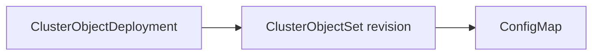

# Manage standalone ClusterObjectDeployments

A `ClusterObjectDeployment` (COD) manages mutable desired content by creating
immutable `ClusterObjectSet` (COS) revisions. This tutorial installs the standalone
experimental object-controller, deploys a ConfigMap, and follows an A → B → A
template change through three forward revisions.

The COD owns its COS revisions through controller owner references. Each COS owns
the Kubernetes objects it manages:



## Prerequisites

- A Kubernetes test cluster where you can install CRDs and cluster-scoped RBAC.
- A schedulable Linux node labeled `node-role.kubernetes.io/control-plane`,
  matching the chart's default node selector. If your cluster lacks this label,
  customize `deployments.templateSpec.nodeSelector` when rendering the chart.
- The `cod-example` namespace must not already exist. The sample creates it;
  cleanup deletes it and all resources in it.
- `kubectl` and Helm, with `kubectl` configured for the test cluster.
- A checkout of this repository. Run the commands below from its root directory.
- An object-controller image built from the checkout and available to the cluster.
  See [Controller deployment](../concepts/clusterobjectsets.md#controller-deployment)
  for build and image configuration details. For KIND, load the image into the
  cluster before installing the controller.

The example uses the new COD name and COS group `cod-example`. Use a fresh group
for the walkthrough: group membership identifies the revision family.

## Install the standalone controller

Set the image reference and install only object-controller and its experimental
APIs:

```sh
OBJECT_CONTROLLER_IMAGE='<your-built-image>'
helm template object-controller helm/olmv1 \
  --set options.featureSet=experimental \
  --set options.objectController.enabled=true \
  --set options.operatorController.enabled=false \
  --set options.catalogd.enabled=false \
  --set-string options.objectController.deployment.image="$OBJECT_CONTROLLER_IMAGE" \
  > /tmp/standalone-object-controller.yaml
kubectl apply -f /tmp/standalone-object-controller.yaml
kubectl -n olmv1-system rollout status deployment/object-controller-controller-manager --timeout=180s
```

This installation uses the chart's existing cluster-admin service account binding
for managing arbitrary Kubernetes resources. ClusterExtension and catalog
controllers are unnecessary for standalone COD use.

## Create the first revision

The sample in `config/samples/olm_v1_clusterobjectdeployment.yaml` creates a
namespace and a COD whose template contains one inline ConfigMap:

```yaml
--8<-- "config/samples/olm_v1_clusterobjectdeployment.yaml"
```

```sh
kubectl apply -f config/samples/olm_v1_clusterobjectdeployment.yaml
kubectl wait --for=condition=Available clusterobjectdeployment/cod-example --timeout=180s
kubectl get clusterobjectdeployment cod-example
kubectl get clusterobjectsets --field-selector spec.group=cod-example
kubectl -n cod-example get configmap cod-example-settings -o jsonpath='{.data.message}{"\n"}'
```

The message is `Hello from revision A`. The COD creates `cod-example-1` with
`spec.group: cod-example`, `spec.revision: 1`, and `spec.lifecycleState: Active`.
Its `Progressing` condition becomes `False` with reason
`NewClusterObjectSetProgressed` after rollout completes, and `Available` becomes
`True`.

The namespace in the sample is created separately from the COD's managed content.
The ConfigMap is owned by the COS. Inspect that ownership and record the
ConfigMap's UID for comparison after the update:

```sh
kubectl -n cod-example get configmap cod-example-settings \
  -o jsonpath='{.metadata.ownerReferences[?(@.controller==true)].name}{"\n"}{.metadata.uid}{"\n"}'
```

## Change the template

Change the ConfigMap message to B:

```sh
kubectl patch clusterobjectdeployment cod-example --type=json \
  -p='[{"op":"replace","path":"/spec/template/spec/phases/0/objects/0/object/data/message","value":"Hello from revision B"}]'
kubectl wait --for=create clusterobjectset/cod-example-2 --timeout=180s
kubectl wait --for=condition=Ready clusterobjectset/cod-example-2 --timeout=180s
kubectl -n cod-example get configmap cod-example-settings \
  -o jsonpath='{.data.message}{"\n"}{.metadata.ownerReferences[?(@.controller==true)].name}{"\n"}{.metadata.uid}{"\n"}'
```

The message becomes `Hello from revision B`, ownership moves to `cod-example-2`,
and the ConfigMap keeps its UID. During the handoff, more than one COS can be
Active. An older Ready revision can keep the COD `Available=True` while its
successor is still progressing. Waiting for the new COS to become Ready observes
that specific rollout.

Reapply the original sample to restore A:

```sh
kubectl apply -f config/samples/olm_v1_clusterobjectdeployment.yaml
kubectl wait --for=create clusterobjectset/cod-example-3 --timeout=180s
kubectl wait --for=condition=Ready clusterobjectset/cod-example-3 --timeout=180s
kubectl -n cod-example get configmap cod-example-settings -o jsonpath='{.data.message}{"\n"}'
kubectl get clusterobjectsets --field-selector spec.group=cod-example
```

The message returns to `Hello from revision A` through revision 3. Restoring an
earlier template creates a new, higher revision; an archived revision cannot
become Active again. Reapplying an unchanged template keeps the current revision.

### Which edits create revisions?

| Edit | Result |
| --- | --- |
| Objects, references, phase/object order, probes, or collision protection in `spec.template.spec` | A new revision |
| Labels or annotations in `spec.template.metadata` | A new revision |
| `spec.template.spec.progressDeadlineMinutes` | A new revision, because the deadline is part of the template |
| Root COD labels or annotations | The current revision is retained |
| `spec.revisionHistoryLimit` | Retention changes; the current revision is retained |

Template labels and annotations are placed on each generated COS. Set metadata
for a managed object in that object's manifest. The controller assigns COS group,
revision, lifecycle state, ownership, and the reserved
`olm.operatorframework.io/template-hash` label.

## Read status and diagnose failures

The COD exposes `Available` and `Progressing`. A child COS exposes `Ready` with
the details of its resource reconciliation.

| COD condition | Status | Reason | Meaning |
| --- | --- | --- | --- |
| `Available` | `True` | `Available` | At least one active, non-deleting COS is Ready |
| `Available` | `False` | `NoActiveRevision` | No active, non-deleting COS exists yet |
| `Available` | `False` | `Unavailable` | Active revisions exist, but none are Ready |
| `Progressing` | `True` | `NewClusterObjectSetProgressing` | Waiting to create the desired revision, or rolling out while the COS reports `Pending` or `ObjectsNotReady` |
| `Progressing` | `True` | `RevisionPreconditionsNotMet` | The desired revision's preconditions are unmet, such as a mutable referenced Secret; reconciliation keeps retrying |
| `Progressing` | `False` | `NewClusterObjectSetProgressed` | The desired revision completed rollout at least once |
| `Progressing` | `False` | `ProgressDeadlineExceeded` | An incomplete, still-retrying revision exceeded its rollout budget |
| `Progressing` | `False` | `InvalidSpecification` | Template labels or annotations are invalid; correct them to allow creation |
| `Progressing` | `False` | `RevisionObjectCollision` | The desired revision's objects are owned by another controller or already exist; resolve the conflicting ownership |
| `Progressing` | `False` | `RevisionInvalidSpecification` | The desired revision's objects are invalid; correct the COD template |

For revision-specific reasons, the COD's condition message names the latest
active COS. Inspect that COS's `Ready` condition for the specific cause.
`RevisionInvalidSpecification` concerns the revision's objects, while
`InvalidSpecification` concerns the COD's `spec.template.metadata` and prevents
creation of a new revision.

Inspect the parent, the current child, and the controller logs:

```sh
kubectl describe clusterobjectdeployment cod-example
kubectl get clusterobjectset cod-example-3 -o yaml
kubectl -n olmv1-system logs deployment/object-controller-controller-manager
```

A COS can report `Ready=False` with `PreconditionsNotMet` for a mutable
referenced Secret; before the deadline, the COD reports
`Progressing=True/RevisionPreconditionsNotMet`. A COS reports `ObjectsNotReady`
for objects still waiting on probes. A missing referenced Secret causes a
retryable read error in controller logs and leaves the COS's existing `Ready`
condition unchanged. A newly created COS can remain `Ready=Unknown` with reason
`Pending` until the Secret is available.

Supply the expected immutable Secret content or resolve the readiness failure
and let reconciliation retry. Change the COD template when the desired object
content needs to change. See [COS status conditions](../concepts/clusterobjectsets.md#status-conditions)
for the child reasons.

### Deadlines and recovery

`spec.template.spec.progressDeadlineMinutes` supplies one budget for the whole
revision. The sample uses 10 minutes, the minimum; the maximum is 720 minutes.
Omit the field to disable deadline enforcement.

Timing starts at COS creation. Failed or delayed creation attempts consume no
budget. Completing phases, polling, retries, and controller restarts preserve the
same deadline. A five-phase revision with a ten-minute deadline has ten minutes
total. Each new revision receives a fresh budget.

The COD schedules its own expiry check even when the COS emits no further events.
The deadline still applies while preconditions are unmet: after expiry, the COD
reports `Progressing=False/ProgressDeadlineExceeded` while the COS retains its
readiness failure. `RevisionObjectCollision` and `RevisionInvalidSpecification`
require user action and take precedence over `ProgressDeadlineExceeded`, even
after expiry. The legacy deadline field remains available on directly created
COSs; COD enforces its budget independently.

Reconciliation continues after expiry. Completion of the entire revision records
`COS.status.completedAt` and recovers the COD to
`Progressing=False/NewClusterObjectSetProgressed`. Completing only some phases
does not clear an expired deadline. Once completion is recorded, later health regressions
can affect availability but never restart that revision's rollout timer.

## Inspect history and referenced content

The COS controller archives superseded revisions after handoff and cleans up
objects that were removed from the desired content. COD prunes excess archived
history after teardown completes. Active revisions are excluded from the limit.

The sample retains two archived revisions with `spec.revisionHistoryLimit: 2`.
The default is 5, the supported range is 0–50, and 0 retains no archived revisions.
After A → B → A, revisions 1 and 2 can remain as archived history while revision 3
is Active:

```sh
kubectl get clusterobjectsets --field-selector spec.group=cod-example \
  -o custom-columns=NAME:.metadata.name,REVISION:.spec.revision,STATE:.spec.lifecycleState
```

For larger content, each template object can use the existing COS `ref` mechanism
to read a JSON manifest from an immutable Secret. Create the referenced Secret
before applying the COD; it must remain available for every retained revision
that references it. Changing the intended content requires a new Secret reference
in the template. See [Object storage](../concepts/clusterobjectsets.md#object-storage-inline-vs-references).
Standalone callers manage the lifetime of these content Secrets.

ClusterExtension integration is separate work tracked by
[OPRUN-4744](https://redhat.atlassian.net/browse/OPRUN-4744). The current
ClusterExtension path still creates COSs directly; this standalone workflow uses
object-controller without bundle resolution or catalog components.

For all fields, see the [COD API reference](../../api-reference/olmv1-api-reference.md#clusterobjectdeployment).

## Clean up

Deleting the COD cascades to its owned COSs and managed objects. Wait for the
ConfigMap to disappear before removing the separately created namespace. Only
remove `cod-example` if it was created for this walkthrough and contains no
unrelated resources:

```sh
kubectl delete clusterobjectdeployment cod-example
kubectl -n cod-example wait --for=delete configmap/cod-example-settings --timeout=180s
kubectl delete namespace cod-example
```

After cleaning up the example resources, remove the standalone installation only
if every resource in the rendered manifest is dedicated to this walkthrough. The
manifest includes the `olmv1-system` namespace and the COD/COS CRDs; deleting them
also deletes the namespace's contents and all COD/COS instances. If any resources
are shared, leave the installation in place:

```sh
kubectl delete -f /tmp/standalone-object-controller.yaml
```
