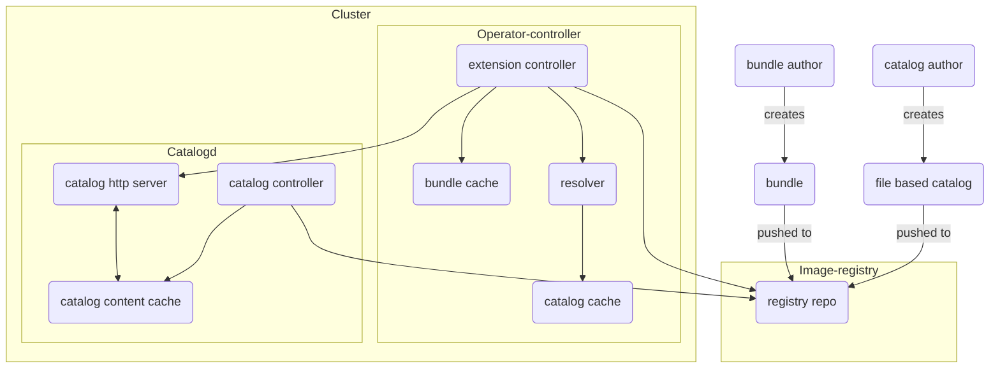
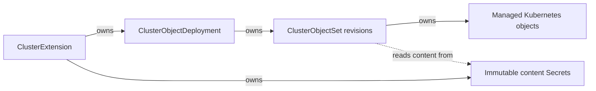

---
hide:
  - toc
---

## OLM v1 Architecture

A standard OLM v1 installation consists of two primary components:

1. [operator-controller](https://github.com/operator-framework/operator-controller/tree/main/cmd/operator-controller)
2. [catalogd](https://github.com/operator-framework/operator-controller/tree/main/cmd/catalogd)

An optional third component,
[object-controller](https://github.com/operator-framework/operator-controller/tree/main/cmd/object-controller),
reconciles `ClusterObjectDeployment` (COD) and `ClusterObjectSet` (COS) resources.
The experimental `BoxcutterRuntime` uses this component for extension rollouts.
Object-controller can also be deployed independently, without operator-controller,
catalogd, or their APIs.

This page describes the core controller architecture, not an exhaustive list of
experimental features. For the current feature-gate configuration, see the chart's
[standard defaults](https://github.com/operator-framework/operator-controller/blob/main/helm/olmv1/values.yaml)
and [experimental overrides](https://github.com/operator-framework/operator-controller/blob/main/helm/experimental.yaml).
Experimental runtime details below describe the current implementation and may
change; see the [API stability policy](public-api.md#experimental-apis-and-fields).

The diagram below shows catalog and bundle discovery, which is shared by both
runtimes. The [experimental rollout flow](#object-controller-experimental) describes
how object-controller deploys the rendered content.

### Architecture Diagram

!!! note
    The direction of the arrows represents the flow of communication. If an arrow starts from A and points to B, it indicates that A retrieves or consumes information from B, unless otherwise specified.

---

### operator-controller

The `operator-controller` is the core component of OLM v1. Its responsibilities include:

- Managing a cache of catalog metadata provided by catalogD through its HTTP server.
- Ensuring the catalog metadata cache is kept up-to-date with the latest catalog state.
- Identifying the appropriate `registry+v1` bundle that meets the constraints defined in the `ClusterExtension` resource (e.g., package name, version, channel) based on the cluster's current state.
- Unpacking bundles and rendering their manifests.
- Applying rendered manifests through the Helm-based runtime in standard installations, or applying a COD template and observing its rollout when `BoxcutterRuntime` is enabled.

The operator-controller has three key sub-components:

1. **Cluster Extension Controller**:
    - Queries catalogD (via its HTTP server) to retrieve catalog information.
    - Saves catalog information in the catalog cache and automatically updates the cache if a catalog has a new image reference.
    - Downloads bundle container images from the registry, saves them to the bundle cache, and unpacks and renders their manifests.
    - In the standard runtime, applies the rendered content through Helm. With `BoxcutterRuntime`, creates immutable content Secrets and applies a COD; object-controller handles the phased rollout.
    - Handles bundle upgrades by determining which bundle is the correct one to apply.

2. **Resolver**:
    - Assists the Cluster Extension Controller by filtering bundle references according to user-defined restrictions (e.g., package name, priority). It returns the filtered bundle reference to the extension controller.

3. **Bundle Cache**:
    - Stores previously unpacked bundles. If a bundle is not already cached, it downloads and caches it for future use.

---

### catalogd

catalogd is responsible for unpacking [file-based catalog (FBC)](https://olm.operatorframework.io/docs/reference/file-based-catalogs/#docs) content, which is packaged and delivered as container images. It allows on-cluster clients to discover installable content by providing access to this metadata. In the future, catalogD will also support other sources like Git repositories and OCI artifacts.

catalogd has three main sub-components:

1. **ClusterCatalog Controller**:
    - Pulls FBC-based catalog images from the registry and unpacks them into the catalog content cache.
    - Reconciles any changes in the catalog and ensures the latest content is reflected in the cluster.

2. **CatalogD HTTP Server**:
    - Serves catalog information to clients, such as the Cluster Extension Controller.

3. **CatalogD Content Cache**:
    - A cache maintained by the Catalog Controller that stores unpacked catalog data, which the CatalogD HTTP Server uses to respond to client queries.

---

### object-controller (experimental)

Object-controller separates mutable deployment intent from immutable resource
revisions. It runs in its own Deployment with its own service account and
leader-election lease. The Helm chart enables it alongside operator-controller
when `BoxcutterRuntime` is enabled; standard installations do not enable it.

It contains two controllers:

1. **ClusterObjectDeployment Controller**:
    - Creates and owns immutable COS revisions from a mutable COD template.
    - Reports deployment availability and rollout progress, enforces rollout
      deadlines, and prunes excess archived revision history.

2. **ClusterObjectSet Controller**:
    - Applies a revision's objects in ordered phases using server-side apply.
    - Evaluates readiness and records the revision's first successful completion.
    - Handles object ownership handoff between revisions, archival, and teardown.

With `BoxcutterRuntime`, the resource ownership chain is:

Operator-controller resolves the bundle, renders its content, creates the
ClusterExtension-owned Secrets, and applies the COD. Object-controller reconciles
COD and COS resources without performing bundle resolution or querying catalogs.
Operator-controller observes COD status to report the ClusterExtension's progress
and installation state. Pruning COS history does not delete the content Secrets;
those are garbage collected when their owning ClusterExtension is deleted.

For standalone use, callers submit COD templates or COS revisions directly and
manage the lifetime of any referenced content Secrets themselves. The default
object-controller service account has cluster-admin privileges because it manages
arbitrary Kubernetes resources.

See [ClusterObjectDeployments](../draft/concepts/clusterobjectdeployment.md),
[ClusterObjectSets](../draft/concepts/clusterobjectsets.md), and the
[standalone tutorial](../draft/tutorials/manage-clusterobjectdeployments.md)
for the experimental API contracts and installation instructions.
